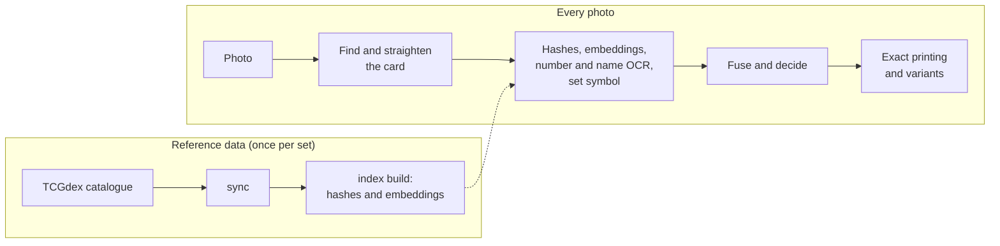

<p align="center">
  
</p>

<p align="center">
  <strong>Know your cards. Keep it local.</strong>
</p>

<p align="center">
  <a href="https://pokeum.wena.one"><strong>Try it live</strong></a>
  &middot;
  <a href="#quick-start">Self-host</a>
  &middot;
  <a href="openwiki/quickstart.md">Documentation</a>
  &middot;
  <a href="https://github.com/TBLgGamin/pokeum/releases">Releases</a>
</p>

<p align="center">
  <a href="https://github.com/TBLgGamin/pokeum/actions/workflows/ci.yml"></a>
  <a href="https://github.com/TBLgGamin/pokeum/releases/latest"></a>
  <a href="LICENSE"></a>
  
</p>

---

pokeum identifies Pokémon trading cards from a photo. Point your phone at a card and it names the exact printing (card, set and collector number, for example *Pikachu, Paldea Evolved, 025/193*) along with print variants such as reverse holo or 1st Edition. Scan a stack, keep the list in your browser and export it to the tracker you already use.

It is self-hosted and needs no account: a single Python service runs recognition on the CPU and serves an installable web app. Nothing about your collection leaves your device unless you export it.

## Table of contents

- [Features](#features)
- [Try it](#try-it)
- [Quick start](#quick-start)
- [Usage](#usage)
- [Configuration](#configuration)
- [How it works](#how-it-works)
- [Deployment](#deployment)
- [Development](#development)
- [Contributing](#contributing)
- [Security](#security)
- [Acknowledgements](#acknowledgements)
- [License](#license)

## Features

- **Hands-free scanning.** Hold a card in the guide and it is captured as soon as the frame is usable; when one frame is not decisive, a few more are taken and combined.
- **Exact printings, not just names.** Perceptual hashes, a fine-tuned DINOv2 image encoder, OCR of the collector number and the card name, and set-symbol matching are fused into one ranked answer. Reprints that share artwork are told apart by their printed details.
- **Print variants.** Reverse holo, 1st Edition, shadowless and promo stamps.
- **Robust to real photos.** Cards upside down, sideways, in sleeves, at an angle or under glare are handled.
- **No retraining for new sets.** Recognition is a lookup against reference images from [TCGdex](https://tcgdex.dev); a new set becomes recognisable after one data sync.
- **Photo upload.** Identify cards from existing photos as well as the live camera.
- **Collection export.** TCGplayer CSV, a full spreadsheet CSV, Pokémon TCG Live deck lists, a readable checklist and a JSON backup.
- **Installable web app.** Add it to your home screen on Android or iOS for a full-screen app with offline card art.
- **Runs on modest hardware.** ONNX Runtime on the CPU; no GPU and no PyTorch at runtime.

## Try it

A hosted instance runs at **[pokeum.wena.one](https://pokeum.wena.one)**. Open it on a phone, allow camera access and hold a card in the frame.

Your collection is stored only in that browser. There is no account or cloud copy, so export it before clearing site data or switching devices.

## Quick start

### Prerequisites

- Python 3.13 or newer
- Node.js 22 or newer (only to build the web app)
- About 2 GB of free disk space on the machine that builds the index

### Installation

```bash
git clone https://github.com/TBLgGamin/pokeum.git
cd pokeum

python -m venv .venv
source .venv/bin/activate          # Windows: .venv\Scripts\activate
pip install -r requirements.txt

# Fine-tuned image encoder (about 85 MB)
curl -L --create-dirs -o data/models/dinov2s-ft-v1.onnx \
  https://github.com/TBLgGamin/pokeum/releases/latest/download/dinov2s-ft-v1.onnx

# Card catalogue from TCGdex, then the matching index (run once, and after new sets)
python main.py sync
python main.py index build

# Web app
cd frontend && npm ci && npm run build && cd ..

# Serve the API under /api and the web app at /
python main.py serve
```

Open <http://127.0.0.1:8000>. Browsers only allow the camera on HTTPS or `localhost`; see [Deployment](#deployment) for serving it to a phone.

## Usage

### Web app

| Screen | What it does |
| --- | --- |
| Scan | Live camera with automatic capture. Confirm the match to add it to your collection. |
| Upload | Identify a card from a photo on your device. |
| Collection | Search your cards, adjust quantities and export. |

### Command line

```bash
python main.py identify path/to/card.jpg     # identify one image
python main.py scan                          # live webcam recognition
python main.py serve --host 0.0.0.0          # HTTP service and web app
python main.py eval data/eval/real           # accuracy scorecard over labelled images
python main.py bench path/to/card.jpg        # latency and throughput
```

Run `python main.py <command> --help` for every option.

### HTTP API

| Method | Path | Description |
| --- | --- | --- |
| `POST` | `/api/identify` | Identify one image (multipart field `file`). |
| `POST` | `/api/identify/burst` | Identify one card from up to four frames (multipart field `files`). |
| `GET` | `/api/cards/{card_id}` | Card details. |
| `GET` | `/api/cards/{card_id}/image` | Reference image. |
| `GET` | `/api/health` | Readiness, indexed card count and the active encoder. |

Request and response shapes are documented in [`openwiki/service-and-cli.md`](openwiki/service-and-cli.md).

## Configuration

pokeum is configured through environment variables, and `main.py` loads a local `.env` file if one exists. Every setting, its default and its purpose is listed in [`.env.example`](.env.example). The most common ones:

| Variable | Default | Purpose |
| --- | --- | --- |
| `DATA_DIR` | `./data` | Catalogue, index and model location |
| `EMBED_MODEL_PATH` | `./data/models/dinov2s-ft-v1.onnx` | Image encoder; when missing, a simpler fallback is used |
| `API_HOST` / `API_PORT` | `127.0.0.1` / `8000` | Bind address of `serve` |
| `IDENTIFY_MAX_CONCURRENCY` | `2` | Recognitions run in parallel before requests are shed with `503` |
| `FRONTEND_DIST_DIR` | `./frontend/dist` | Built web app served at `/` |

## How it works

pokeum never learns individual cards. It downloads a clean reference image of every card once, fingerprints each one and stores the fingerprints in an index. Recognising a photo means finding the card in it, straightening it, fingerprinting it the same way and looking it up.



The image encoder is a DINOv2-small model fine-tuned once on synthetic photo damage (glare, perspective, blur, fingers) so that it ignores the camera rather than memorising cards. That is why new sets need no training. The full pipeline, its thresholds and measured accuracy are described in [`openwiki/recognition-pipeline.md`](openwiki/recognition-pipeline.md), and the training harness is in [`training/`](training/README.md).

## Deployment

The service is one process. Run `python main.py serve` under a process manager and put TLS in front of it, for example a reverse proxy or a Cloudflare Tunnel to `http://127.0.0.1:8000`. A production host needs only the catalogue database, the index, the set symbols and the model (about 165 MB); card images are served from the TCGdex CDN.

[`deploy/`](deploy/README.md) contains a systemd unit, a Cloudflare Tunnel example and step-by-step notes.

## Development

```bash
pip install -r requirements.txt -r requirements-dev.txt
git config core.hooksPath .agents/git-hooks     # enable the pre-commit checks
cd frontend && npm ci && npm run dev            # Vite dev server, proxies /api to :8000
```

| Check | Command |
| --- | --- |
| Lint and format | `python -m ruff check .` and `python -m ruff format --check .` |
| Types | `python -m mypy` |
| Tests | `python -m pytest` and `npm test` in `frontend/` |
| Security | `python -m bandit -c pyproject.toml -r app main.py` |

The test suite runs offline. CI runs every check on each push and pull request, and a green build on `main` with a new version in `pyproject.toml` publishes a release automatically.

Architecture and module documentation for contributors (and coding agents) lives in [`openwiki/`](openwiki/quickstart.md); shared agent rules and skills live in [`.agents/`](AGENTS.md).

## Contributing

Bug reports, ideas and pull requests are welcome. Read [CONTRIBUTING.md](CONTRIBUTING.md) for the setup, conventions and commit format, and follow the [Code of Conduct](CODE_OF_CONDUCT.md).

## Security

Please report vulnerabilities privately as described in [SECURITY.md](SECURITY.md) rather than in a public issue.

## Acknowledgements

- [TCGdex](https://tcgdex.dev) for the free card catalogue and image CDN.
- [DINOv2](https://github.com/facebookresearch/dinov2) by Meta AI (Apache 2.0), the base of the image encoder. The fine-tuned weights are published on the [Releases](https://github.com/TBLgGamin/pokeum/releases) page under Apache 2.0.
- [RapidOCR](https://github.com/RapidAI/RapidOCR) for text recognition.

pokeum is a fan project and is not affiliated with, endorsed or sponsored by Nintendo, Creatures Inc., GAME FREAK inc. or The Pokémon Company International. Pokémon and Pokémon character names are trademarks of Nintendo. Card images belong to their respective rights holders and are served from TCGdex.

## License

pokeum is released under the [MIT License](LICENSE). The fine-tuned encoder weights are released under Apache 2.0.
