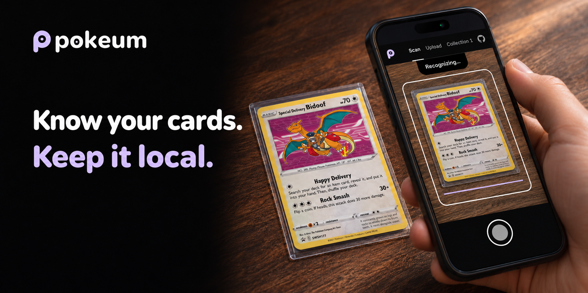
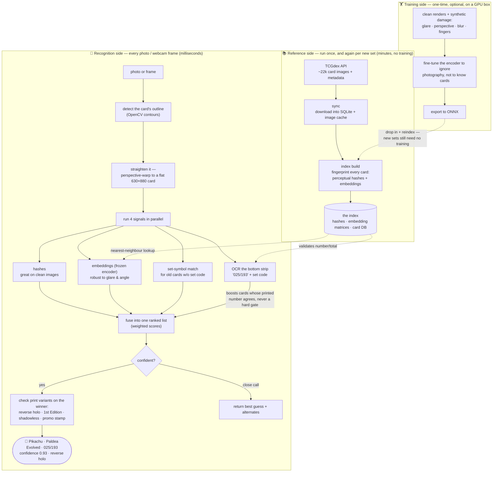

# pokeum

[](https://github.com/TBLgGamin/pokeum/actions/workflows/ci.yml)
[](LICENSE)




Point your phone at a Pokémon card and pokeum tells you **exactly which printing it is** — name, set, and collector number (e.g. *Pikachu · Paldea Evolved · 025/193*) plus print variants like reverse holo or 1st Edition. Scan card after card, build your collection, export it as a TCGplayer-ready CSV.

Fully self-hosted: a FastAPI recognition service plus an installable web app (PWA). No accounts, no cloud dependency, no per-scan fees.

<!-- TODO: in-app screenshots — docs/media/scan.gif (live scan → match sheet) and docs/media/collection.png (collection grid) -->

## Features

- **📸 Live camera scanning** — point, tap, confirm. A guide frame crops the capture; the match sheet shows the card art for a one-tap save. Photo upload works too.
- **🧠 Multi-signal recognition, no per-set training** — perceptual hashes + a fine-tuned DINOv2 image encoder (ONNX, CPU-only at runtime) + OCR of the collector number and the card name + set-symbol matching, fused into one confidence-ranked answer. Upside-down and sideways cards are handled, and an unsure camera scan quietly takes a few more frames before answering. A newly released set becomes recognizable with one data sync — never a retrain.
- **✨ Variant detection** — reverse holo, 1st Edition, shadowless, promo stamps.
- **📱 Installable app** — the website is a PWA: "Add to Home Screen" on Android and iOS gives an app icon, fullscreen launch, offline card art, and a collection that persists on the device.
- **📤 Collection export** — TCGplayer-style CSV.
- **🔒 Your infrastructure** — one Python service serves both the API and the built frontend as a single origin. Card images come straight from the TCGdex CDN, so the server stays lean (~250 MB of data artifacts).

## Quickstart (self-host)

Requirements: Python 3.13+, Node 22+ (only to build the frontend), ~2 GB disk for the full catalogue on the machine that builds the index.

```bash
# 1. backend deps
python -m venv .venv && . .venv/Scripts/activate   # or bin/activate on Linux
pip install -r requirements.txt

# 2. the fine-tuned image encoder (one file, ~85 MB, from GitHub Releases)
curl -L --create-dirs -o data/models/dinov2s-ft-v1.onnx \
  https://github.com/TBLgGamin/pokeum/releases/latest/download/dinov2s-ft-v1.onnx

# 3. reference data: download the card catalogue from TCGdex (once, ~20k cards)
python main.py sync

# 4. precompute the matching index (hashes + embeddings)
python main.py index build

# 5. build the web app
cd frontend && npm ci && npm run build && cd ..

# 6. serve — API under /api, web app at the root
python main.py serve            # http://127.0.0.1:8000
```

Or skip the frontend and use the CLI directly:

```bash
python main.py identify my_card_photo.jpg
python main.py scan             # live webcam mode
```

Configuration is environment-based with sensible defaults — see [`.env.example`](.env.example) for every key (`python main.py` auto-loads a local `.env`).

> **Camera + install need HTTPS.** Browsers only expose the camera and the PWA install prompt on secure origins. For production put the service behind TLS — a [Cloudflare Tunnel](deploy/README.md) or any reverse proxy works; `localhost` is exempt during development.

### Install it as an app

Open your deployed site on a phone:

- **Android (Chrome):** tap the "Install app" prompt, or ⋮ → *Add to Home screen*.
- **iOS (Safari):** Share → *Add to Home Screen*.

Scanned collections are stored on the device and survive restarts; card art is cached for offline viewing.

## How it works

pokeum never trains a model to recognize cards — it **looks cards up**. Every card has a clean reference image on [TCGdex](https://tcgdex.dev); pokeum downloads those once, fingerprints each (perceptual hashes + embeddings from a **frozen** encoder), and stores them in an index. Recognizing a photo is: find the card's outline, perspective-flatten it, fingerprint it the same way, and take the nearest neighbour — with the OCR'd collector number settling ties between reprints that share artwork.



The encoder was fine-tuned once, on synthetic photo distortions (glare, perspective, blur, fingers), to learn that a bad photo of a card *is* that card — it learned to ignore cameras, not to memorize cards, which is why new sets never need training. Runtime inference is ONNX on CPU; PyTorch is never a server dependency.

Deeper docs live in [`openwiki/quickstart.md`](openwiki/quickstart.md) — the recognition pipeline, reference data, service/CLI surface, and the optional training harness.

## Deployment

The service is a single process: run `python main.py serve` under your process manager of choice (systemd, Docker, …) and put TLS in front of it (reverse proxy or a Cloudflare Tunnel pointing at `http://127.0.0.1:8000`). A production server only needs ~165 MB of data artifacts — `data/reference.db`, `data/index/`, `data/symbols/`, and the ONNX model; card images are served from the TCGdex CDN, so `data/images/` (~380 MB) can stay on the machine that built the index. Recommended production env: `API_HOST=127.0.0.1`, `LOG_JSON=true`, `FRONTEND_DIST_DIR=./frontend/dist`.

## Development

```bash
pip install -r requirements.txt -r requirements-dev.txt
git config core.hooksPath .agents/git-hooks   # enable the commit guards (once per clone)
cd frontend && npm ci && npm run dev   # Vite dev server proxying /api to :8000
```

The quality gate (`ruff check`, `ruff format --check`, `mypy`, `bandit`, `pytest`) runs in CI and on demand; the commit hook enforces Ruff on the staged files plus the semver, docs-freshness and no-`.env` guards. The test suite is fully offline. See [CONTRIBUTING.md](CONTRIBUTING.md).

This repo also ships a self-enforcing agent workflow that works with any coding agent: rules and skills in a single `.agents/` folder, a git pre-commit hook that gates commits on doc freshness and semver, and agent-oriented docs in `openwiki/`. If you work with coding agents it's a working reference setup — see [`openwiki/workflow.md`](openwiki/workflow.md); if you don't, it stays out of your way.

## Credits & legal

- **[TCGdex](https://tcgdex.dev)** — the free, keyless card catalogue and image CDN this project is built on.
- **[DINOv2](https://github.com/facebookresearch/dinov2)** (Meta AI, Apache 2.0) — the image encoder backbone. The fine-tuned encoder weights (`dinov2s-ft-v1.onnx`, a DINOv2-small derivative) are published on this repo's [Releases](https://github.com/TBLgGamin/pokeum/releases) page under Apache 2.0 — use them however you want; the full training harness to reproduce or improve them is in [`training/`](training/README.md).
- **[RapidOCR](https://github.com/RapidAI/RapidOCR)** — collector-number OCR.

pokeum is a fan-made tool, not affiliated with, endorsed, or sponsored by Nintendo, Creatures Inc., GAME FREAK inc., or The Pokémon Company International. Pokémon and Pokémon character names are trademarks of Nintendo. Card images remain © their respective rights holders and are served from TCGdex.

## License

[MIT](LICENSE)
